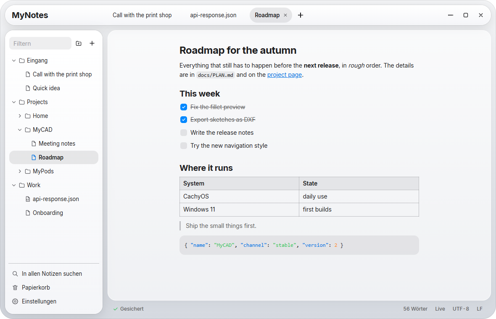
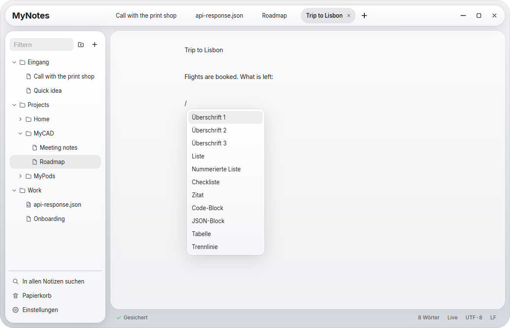
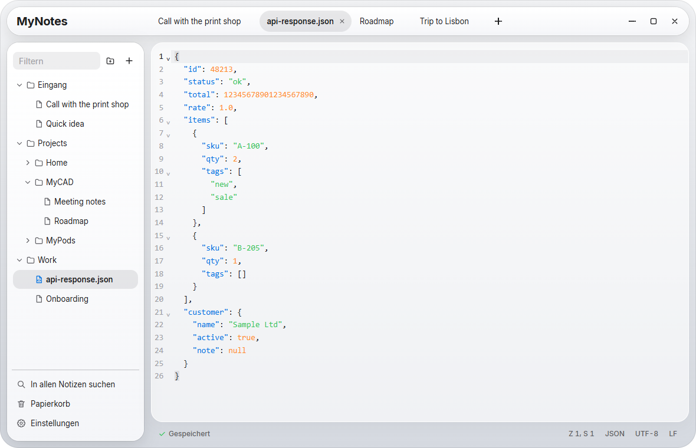
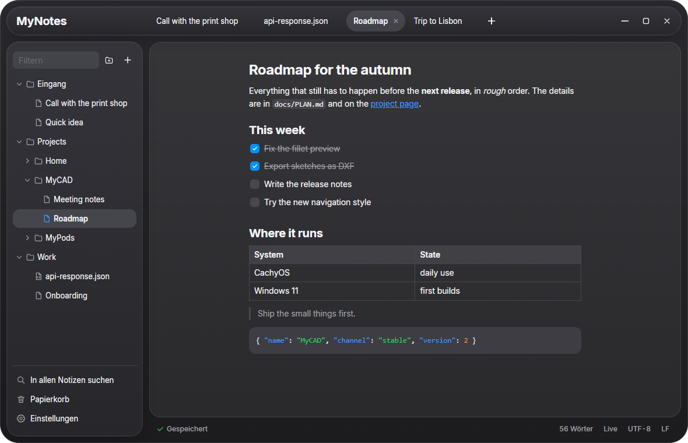

<div align="center">

# MyNotes

### Never hit save again.

Type. Close it. It's still there.<br>
The tabs of Notepad++ and the structure of a wiki, with a Markdown editor like Notion. In the look of Liquid Glass, on CachyOS and Windows 11.

<br>

[](LICENSE)


<br>



</div>

> [!NOTE]
> MyNotes is a personal project in active development. It is built on Windows 11 and tested there and in an Arch Linux container, but it has not run on a real CachyOS desktop yet. The interface is in German only for now.

> [!WARNING]
> **This project is vibe-coded.** The code was written with an AI coding assistant. Expect rough edges, and read the code before you rely on it. Set up a second backup location before you trust it with anything you can't lose.

<br>

Contents: [Saving](#close-it-kill-it-its-still-there) · [Tabs](#open-a-tab-start-typing) · [Tree](#a-wiki-not-a-pile-of-tabs) · [Markdown](#markdown-without-the-markup) · [JSON](#json-pretty-numbers-intact) · [Code](#still-notepad-at-heart) · [Look](#glass-light-or-dark) · [Failures](#when-things-go-wrong) · [Tech specs](#tech-specs) · [Install](#download-install-done) · [Building](#or-build-it-yourself-in-two-commands) · [Testing](#tested-again-and-again) · [Limitations](#what-doesnt-work-yet) · [Origins](#origins-and-license)

<br>

## Close it. Kill it. It's still there.

MyNotes has no save button and no "Do you want to save?" dialog. Close the window, restart the computer or kill the process, and every tab comes back with its text, its order and its cursor.

Each open document has its own journal on the local disk. Within 150 ms of a keystroke (1 s once a text is over 1 MB) the change is written there and flushed with `fsync`, and only then does the status bar say **Gesichert** (saved). Notepad++ backs up every 7 seconds by default. After 1.5 s without typing, or after 10 s at the latest, the note goes to your notes folder. It is written to a temporary file first and then renamed over the old one, so a crash can't leave half a note behind.

Three more things catch what the journal can't:

- The history keeps the state before your first change, a version every 5 minutes and one when you close the tab. Nothing in it is deleted automatically.
- Deleting moves a note to `.trash` in your notes folder. Only emptying the trash deletes for real, and you have to confirm that.
- A second backup location in the settings, such as another drive or a NAS, gets a copy of your notes and history. Nothing there is ever deleted.

Your notes are plain files. You can open them with anything, or sync them with Nextcloud, OneDrive or Git.

<br>

## Open a tab. Start typing.

Press `Ctrl+T` and type, the same as in Notepad++. With the first character the tab becomes a real file in the folder `Eingang` (inbox), named after the start of its first line (40 characters at most, cut at a word). Right-click the `+` to open a file, a note or a closed tab instead. Rename it or drag it into a folder and the name stays yours from then on. A tab you never typed in leaves nothing behind.

Closing a tab never asks anything, and `Ctrl+Shift+T` brings it back.

<br>

## A wiki. Not a pile of tabs.

The sidebar shows your notes folder as a tree, with folders and subfolders as deep as you like. Drag notes and folders to move or sort them, like the page tree in Confluence. Your order is kept in `.mynotes/order.json`, so it travels with the folder.

Moving and renaming never overwrite anything: a taken name gets a number. Open tabs and the history follow the file. The filter narrows the tree as you type, `Ctrl+P` opens a note by name and `Ctrl+Shift+F` searches all notes, with regular expressions if you want them.

You choose the notes folder in the settings. Switching copies everything to the new folder and checks every file against a checksum, and the old folder stays as it is.

<br>

## Markdown without the markup.

<div align="center">



</div>

Type `# ` and you have a heading. `**bold**` turns bold and `- [ ] ` becomes a checkbox. You see the formatted text, and the file on disk is ordinary Markdown.

`/` opens the block menu with headings, lists, checklists, quotes, code blocks, tables and dividers. Select text and a formatting bar appears. Inside a table, the same bar adds and removes rows and columns. A pasted image lands in the notes folder.

`Ctrl+/` shows the Markdown source of any note and switches back.

> [!IMPORTANT]
> The live editor writes the Markdown again when it saves, so your file may change in ways you didn't type. `5 * 3` can become `5 \* 3` and a `*` list can become a `-` list, with the same meaning. Opening a note never writes to it, and the untouched original goes into the history before the first change. A note whose meaning would change, with embedded HTML for example, opens in the source view instead.

<br>

## JSON. Pretty. Numbers intact.

<div align="center">



</div>

`Ctrl+Alt+J` formats the selection, the code block under the cursor or the whole file. `Ctrl+Alt+Shift+J` compresses it again.

Most formatters parse the JSON and print it back, which rounds `12345678901234567890`, turns `1.0` into `1` and drops duplicate keys. This one only touches whitespace. If the JSON is broken it changes nothing and tells you the line and column. JSON pasted into an empty note turns the note into a `.json` file, and JSON pasted into a note with text becomes a code block.

<br>

## Still Notepad++ at heart.

Everything that isn't Markdown opens in the code editor, built on CodeMirror, which leaves your text exactly as it is. Syntax highlighting covers 143 languages. Encoding and line endings are kept, and you can change them in the status bar (UTF-8, UTF-16, Windows-1252, LF, CRLF, CR). Open any file with `Ctrl+O`, by drag and drop or from the command line.

| Keys | Does |
|------|------|
| `Ctrl+T`, `Ctrl+W`, `Ctrl+Shift+T` | New tab, close tab, bring it back |
| `Ctrl+Tab` | Next tab |
| `Ctrl+P` | Open a note by name |
| `Ctrl+Shift+P` | All commands: sort lines, remove duplicates, trim, upper and lower case |
| `Ctrl+F`, `Ctrl+H` | Find and replace, with regular expressions, in both editors |
| `Ctrl+Shift+F` | Search all notes |
| `Ctrl+S` | Write to the notes folder right now, if you can't help it |
| `Ctrl+D`, `Ctrl+L` | Duplicate line, delete line |
| `Ctrl+Shift+↑` / `↓` | Move line |
| `Alt` + drag, `Ctrl` + click | Column selection, several cursors |
| `Ctrl+,` | Settings |

<br>

## Glass. Light or dark.

<div align="center">



</div>

The look follows [MyStyle](https://github.com/HanreichC/MyStyle), like MyPods and MyCAD: `tokens.css` and `components.css` are copied over unchanged. The sidebar and tabs are glass panes over the content. The appearance is light, dark or follows the system, and a Liquid Glass slider goes from clear to tinted. Increase contrast, Reduce transparency and Reduce motion are built in.

If transparency effects are off in Windows, MyNotes follows and shows a matte surface instead.

<br>

## When things go wrong.

| What happens | What MyNotes does |
|--------------|-------------------|
| The app crashes or gets killed | At the next start every journal is read back and your text returns. A half-written last record is detected and dropped. |
| The window crashes | It reloads with all its tabs. |
| The notes folder is gone (USB stick, network, full disk) | You keep typing into the journal, the status bar warns you and MyNotes retries every 5 s. It never creates a replacement folder where the stick used to be. |
| A file is locked by a virus scanner or OneDrive | MyNotes retries with growing pauses, then treats it like a missing folder. |
| A file changed outside the app, your tab is unchanged | The tab reloads. The previous state stays in the history. |
| A file changed outside the app, your tab has edits | Your tab keeps its text and the other version lands next to it as `Name (extern geändert 2026-11-04 1532).md`. |
| A note was deleted outside the app | Its last state goes to the trash. |
| You type a character the file's encoding can't hold | The file switches to UTF-8, keeps the character and tells you. |
| You start MyNotes twice | The running window comes to the front and opens the file. |

<br>

## Tech specs

| | |
|---|---|
| Platform | CachyOS and Windows 11 |
| Interface | MyStyle with glass, light, dark or automatic, German |
| Live editor | TipTap (ProseMirror), Markdown on disk |
| Code editor | CodeMirror 6, 143 languages |
| Saving | Journal with `fsync` within 150 ms, atomic write to the folder after 1.5 s |
| Safety net | History, trash, conflict copies, second backup location |
| Storage | Plain files in a folder you choose |
| Encodings | UTF-8, UTF-16 LE and BE, Windows-1252, with LF, CRLF or CR |
| File size | Up to 128 MB; Markdown above 2 MB opens as source |
| Runtime | Electron 45, sandboxed window, no network requests of its own |
| License | GPL-3.0 |

<br>

## Download. Install. Done.

The latest version is always on the [Releases](https://github.com/HanreichC/MyNotes/releases/latest) page. Every push to `main` becomes a release `vX.Y.N` once the tests pass on both systems.

On Windows, run `MyNotes-x64.msi`. It installs for your user, without administrator rights. It isn't signed, so SmartScreen warns you the first time.

On CachyOS, run the AppImage, with nothing to install:

```sh
chmod +x MyNotes-x86_64.AppImage
./MyNotes-x86_64.AppImage
```

Or build an Arch package with `npm run dist` in the dev container and install it:

```sh
sudo pacman -U release/mynotes-0.1.0.pacman
```

### Where your data lives

| What | Windows | CachyOS |
|------|---------|---------|
| Notes (changeable in the settings) | `%USERPROFILE%\MyNotes` | `~/MyNotes` |
| Journal, history, settings | `%LOCALAPPDATA%\MyNotes` | `~/.local/share/MyNotes` |

The journal stays on the local disk on purpose, so it keeps working when the notes folder is on a network drive or gets unplugged.

<br>

## Or build it yourself. In two commands.

```sh
npm ci
npm start
```

You need Node.js 22 or newer. Everything else stays in the project folder. `npm run dist` builds the packages into `release/`.

For Linux there is an Arch dev container in [`.devcontainer/`](.devcontainer), so the packages and tests match CachyOS.

<br>

## Tested. Again and again.

```sh
npm test      # storage core, kill loop, JSON formatter, encodings
npm run e2e   # the real app in a real window
```

`npm test` writes to the store from a separate process and kills it at a random moment, 25 times in a row. Every acknowledged line has to be there afterwards. The other tests go through each recovery case, paths that try to leave the notes folder, and every encoding byte for byte.

`npm run e2e` drives the real app: it types, kills the process, starts again and checks that the text is back in the tab and in the file. It also crashes the window, drags notes into folders, restores old versions and opens Markdown samples to check that opening changes nothing. Both run on Windows 11 and in the Arch container.

<br>

## What doesn't work (yet).

- Absolute safety doesn't exist. In a power cut, the last 150 ms of typing can be missing. If the disk dies and no second backup location is set up, your notes die with it. MyNotes also can't detect an SSD that confirms a flush it hasn't done. The kill test proves crash safety. Proving power-loss safety would take pulling the plug on real hardware.
- CachyOS on a desktop with Wayland and a real GPU is untested, only Arch under Xvfb so far. Resizing the window with a real mouse is untested too: Windows reports the edges correctly, but nobody has dragged one yet.
- Text typed in the first few milliseconds after `Ctrl+T`, before the new tab exists, lands in the previous tab.
- The glass has blur, tint and rim, but not the refracting lens of MyPods and MyCAD, which comes from their Qt shader.
- The interface is German only.
- Macros, file compare, hex view, split view, plugins and links between notes aren't implemented. They come if they turn out to be missed.
- Sync between computers isn't built in. Use Nextcloud, OneDrive or Git on the notes folder; conflicts end up as copies next to the note.
- The history only grows. Notes are small, but nothing thins it out yet.
- Search skips files above 5 MB and stops at 500 hits.

<br>

## For developers.

Everything about keeping text safe is in [`src/main/store.js`](src/main/store.js), which has no Electron in it, so the tests can kill it for real. The window is plain JavaScript without a framework, in [`src/renderer/`](src/renderer). The plan and the reasoning are in [`docs/PLAN.md`](docs/PLAN.md) (German).

<br>

## Origins and license.

MyNotes takes its idea from [Notepad++](https://github.com/notepad-plus-plus/notepad-plus-plus) and no code from it. It is built on [Electron](https://www.electronjs.org), [TipTap](https://tiptap.dev), [CodeMirror](https://codemirror.net) and [marked](https://marked.js.org), all under the MIT license, and ships the [Inter](https://rsms.me/inter/) typeface under the SIL Open Font License. Thanks to everyone who works on them.

MyNotes is licensed under the [GNU General Public License v3.0](LICENSE). The libraries and the typeface keep their own licenses.

<sub>MyNotes is an independent project and is not affiliated with Notepad++, Notion Labs, Inc., Atlassian or Apple Inc. Notion and Confluence are trademarks of their owners, and Liquid Glass is a design language by Apple. The names are used here only to describe style and behavior.</sub>
